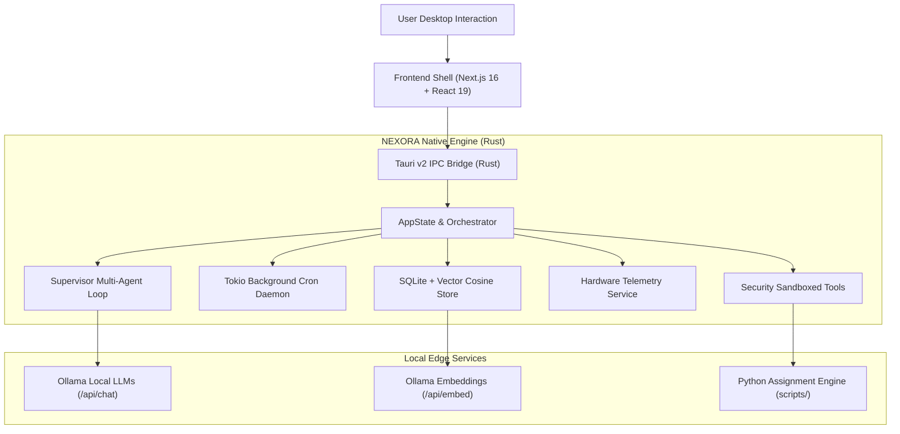

<p align="center">
  
</p>

<h1 align="center">NEXORA</h1>

<p align="center">
  <strong>Autonomous Local-First Multi-Agent Desktop Operating Environment</strong>
</p>

<p align="center">
  <a href="#-key-features"></a>
  <a href="#-key-features"></a>
  <a href="#-key-features"></a>
  <a href="#-key-features"></a>
  <a href="#-key-features"></a>
  <a href="#-key-features"></a>
</p>

<p align="center">
  NEXORA is a high-performance, private, local-first autonomous desktop intelligence assistant. Engineered in <strong>Rust (Tauri v2)</strong> and <strong>Next.js 16</strong>, NEXORA pairs on-device Large Language Models with deep OS-level integration, background cron automations, semantic vector memory (RAG), real-time system telemetry, and an automated handwritten assignment engine.
</p>

---

## 🌟 Key Capabilities

### 1. 🧠 Long-Term Semantic Vector Memory (Local RAG)
- **Local Embedding Generation**: Computes dense vector embeddings locally via Ollama (`nomic-embed-text` / `/api/embed`).
- **Cosine Similarity Engine**: Native vector similarity search in SQLite with live match badges (`🎯 92% Vector Match`).
- **Zero Cloud Leakage**: Personal documents, notes, and past experiences remain stored solely on your physical drive.

### 2. ⏰ Background Automation Daemon & Cron Engine
- **Tokio Async Engine**: Native background daemon running in Rust (`tauri::async_runtime::spawn`) completely decoupled from the UI.
- **Natural Cron Parser**: Flexible scheduling expressions such as `every 10m`, `every 1h`, `daily at 18:00`, or `every 30s`.
- **Automated Task Execution**: Executes scheduled background routines and logs outcomes with status tracking.

### 3. 📝 Authentic Handwritten Assignment Engine
- **Physical Notebook Synthesis**:
  - Warm cream paper background (`#fdfbf6`) with pale blue horizontal ruled lines (`#c4d7ec`).
  - Realistic 3-hole binder punches along the left edge.
  - Double vertical red margin lines (`#e05d5d`, `#f5bcbc`).
- **Multi-Pen Color Palette**:
  - **Black Gel Pen** (`#141b28`): Question prompts, student name, registration number, subject, and date header.
  - **Crimson / Burgundy** (`#881337`): `Ans:` tag featuring an organic hand-drawn wavy underline.
  - **Royal Blue Ballpoint Pen** (`#163466`): Answer text with natural micro-baseline jitter ($\pm 1.2\text{px}$) and pen pressure variance.
- **Margin Numbering**: `Q1.`, `Q2.` margin tags accurately positioned inside the left margin column.
- **Automated Multi-Page PDF**: Automatically tracks page overflow, numbers pages (`PAGE: 01 / 02`), and merges outputs into a college-compliant PDF:
  ```
  <AssignmentName>_<SubjectName>_<RegistrationNumber>.pdf
  ```
- **Word (.docx) Export**: Also supports formatted Microsoft Word document generation.

### 4. 🤖 Multi-Agent Autonomous Execution Loop
- **Supervisor Agent**: Maintains global task state, strategy selection, iteration budgets, and termination decisions.
- **Planner Agent**: Decomposes complex user goals into dependency-aware execution steps.
- **Specialist Agents**: Isolated task executors for coding, research, and tool operations.
- **Evaluation & Diagnostic Agents**: Inspects exit codes, logs, and outputs to automatically diagnose errors and formulate fixes.

### 5. 📊 Real-Time Hardware & System Telemetry
- Real-time CPU core utilization, physical RAM allocation, storage metrics, and active operating system processes with low-overhead Rust polling.

### 6. 🔒 Security Sandbox & Safe Tool Registry
- Sandboxed tools: `list_dir`, `read_file`, `write_file`, `patch_file`, `run_command`, `system_info`.
- Path traversal validation, workspace isolation, execution timeouts, and secret/credential redaction.

---

## 🏗️ Architecture Overview



---

## 📂 Project Structure

```
nexora/
├── src/                          # Next.js 16 Frontend
│   ├── app/                      # App router layouts and root pages
│   ├── components/               # Reactive UI Components
│   │   ├── ChatWorkspace.tsx     # Primary chat & prompt workspace
│   │   ├── MemoryExplorerView.tsx# Vector memory search & Cron scheduler tab
│   │   ├── SystemMonitorView.tsx # Live CPU, RAM, and process telemetry
│   │   ├── ModelManagerView.tsx  # Local Ollama model manager
│   │   ├── AgentTeamView.tsx     # Multi-agent team status
│   │   ├── MindGraphIntelligenceView.tsx # Knowledge graph visualizer
│   │   └── Sidebar.tsx           # Global navigation with NEXORA branding
│   ├── lib/                      # Tauri IPC adapter & TypeScript models
│   └── store/                    # Zustand persistent client state
├── src-tauri/                    # Native Rust Engine (Tauri v2)
│   ├── src/
│   │   ├── lib.rs                # Tauri setup & background Tokio scheduler
│   │   ├── storage/sqlite.rs     # SQLite schema, vector cosine search & jobs CRUD
│   │   ├── ollama/mod.rs         # Ollama LLM client & vector embeddings
│   │   ├── agent/                # Multi-agent state machines & supervisory loops
│   │   ├── commands/mod.rs       # Tauri IPC command definitions
│   │   ├── security/             # Path validation & sandbox isolation
│   │   └── telemetry/            # System hardware metrics collector
│   ├── Cargo.toml                # Rust dependencies (Tauri, Tokio, Rusqlite, etc.)
│   └── tauri.conf.json           # Window & build configurations
├── scripts/
│   └── assignment_engine.py      # Handwritten notebook generator & PDF assembler
├── public/                       # Static branding assets & icons
└── README.md
```

---

## 🚀 Getting Started

### Prerequisites

1. **Rust**: 1.80+ ([rustup.rs](https://rustup.rs/))
2. **Node.js**: v20+ and **pnpm**:
   ```bash
   npm install -g pnpm
   ```
3. **Ollama**: Running locally on `http://127.0.0.1:11434`
   ```bash
   ollama serve
   ollama pull llama3
   ollama pull nomic-embed-text
   ```
4. **Python 3**: (For the assignment rendering engine)
   ```bash
   pip install pillow reportlab python-docx
   ```

---

### Installation & Development

1. **Clone and Install Dependencies**:
   ```bash
   git clone https://github.com/your-username/NEXORA.git
   cd NEXORA
   pnpm install
   ```

2. **Launch Full Desktop App (Tauri v2 + Next.js)**:
   ```bash
   pnpm tauri dev
   ```
   *This automatically compiles the Rust backend, starts Next.js on `localhost:3001`, and opens the native desktop window.*

3. **Frontend Only (Browser Mode)**:
   ```bash
   pnpm dev
   ```
   *Open [http://localhost:3000](http://localhost:3000) to inspect the web interface.*

---

### Running the Handwritten Assignment Generator

You can execute the assignment synthesis engine directly from the CLI:

```bash
python scripts/assignment_engine.py \
  --mode handwritten \
  --assignment "Lab_Assignment_1" \
  --subject "Computer_Networks" \
  --name "Ankit Kumar" \
  --regno "22BCE10482" \
  --data-json "[{\"q\": \"Explain the difference between TCP and UDP.\", \"a\": \"TCP is connection-oriented and reliable. UDP is connectionless and low latency.\"}]" \
  --output-dir "C:/Users/ANKIT/Desktop/assignment_output"
```

> **Artifacts Produced:**
> - `page_01.png` — Rendered lined notebook copy with margin tags and binder holes.
> - `Lab_Assignment_1_Computer_Networks_22BCE10482.pdf` — Submission-ready compiled PDF.

---

### Running Tests

```bash
# Run Rust unit and task tests
cargo test --manifest-path src-tauri/Cargo.toml --test task_tests

# Run frontend test suite
pnpm test
```

---

### Building for Production Release

To create an optimized, standalone Windows binary:

```bash
pnpm build
pnpm exec tauri build --no-bundle
```

The compiled release executable will be available at:
```
src-tauri/target/release/nexora.exe
```

---

## 🛡️ Security & Privacy Architecture

- **Strict Local Sovereignty**: All reasoning, prompts, and vector embeddings remain 100% on your machine.
- **Restricted Subprocess Sandboxing**: System commands execute under explicit timeouts, scoped directory boundaries, and automatic credential scrubbing.
- **Lightweight Footprint**: Unlike heavy Electron wrappers, Tauri utilizes the native system webview, consuming under **150 MB of RAM** at runtime.

---

## 📜 License

Distributed under the **MIT License**. See `LICENSE` for more information.
